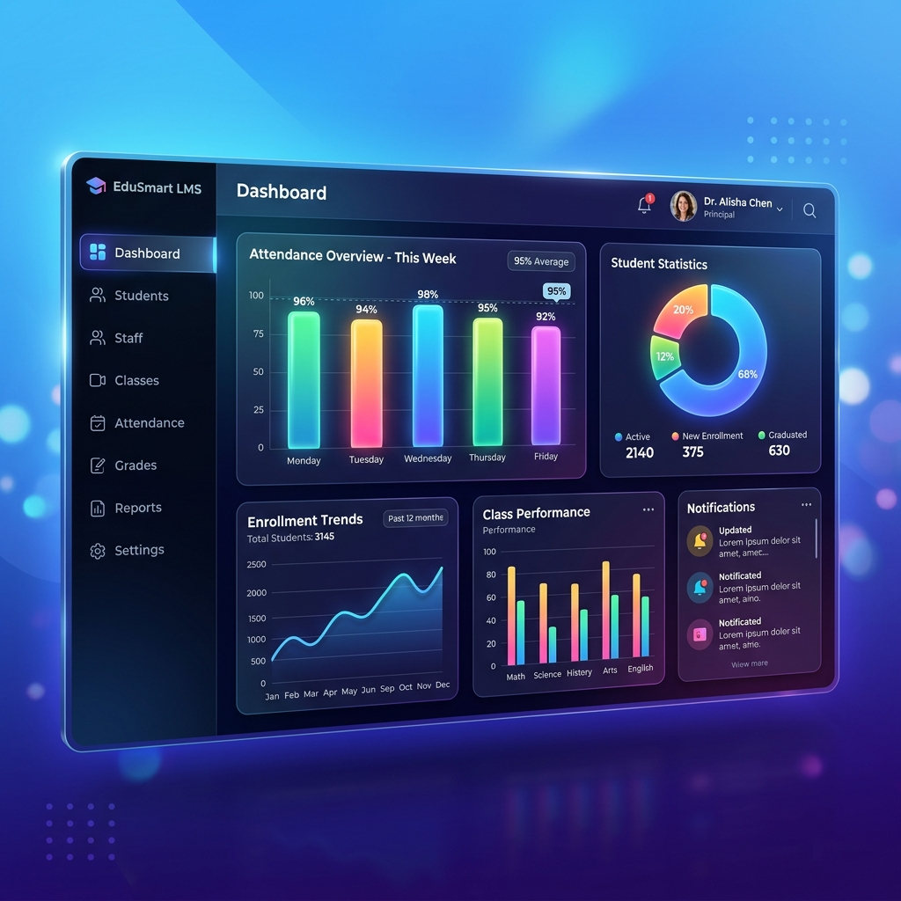
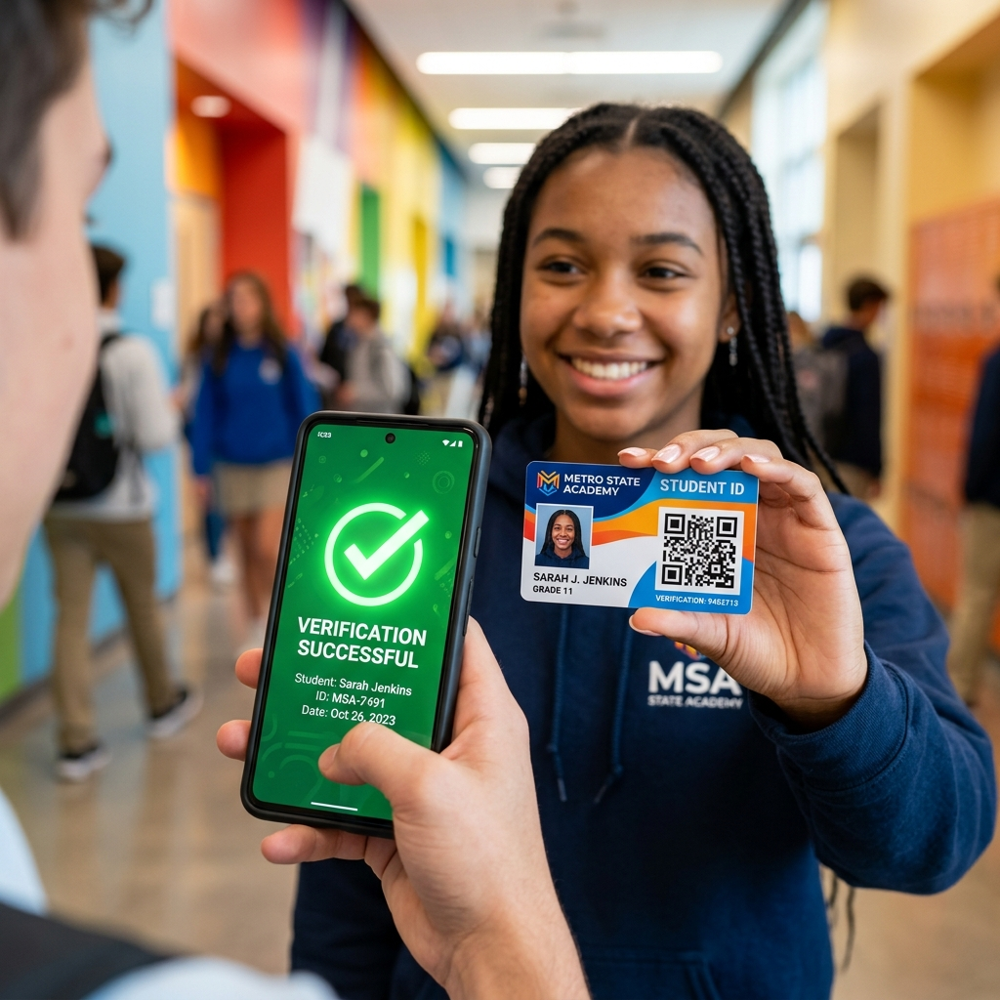
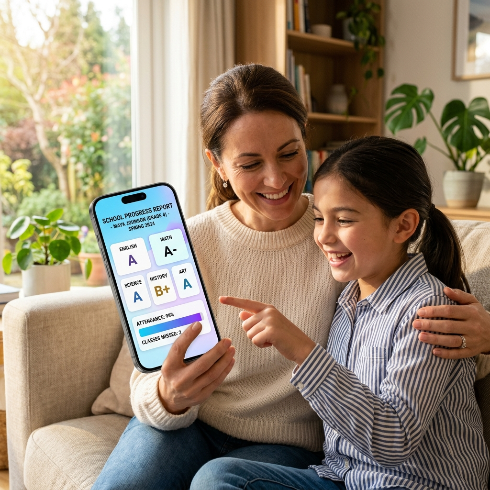

# 🚀 Digital Marketing & Launch Kit: ILM POSSIBLE Education

Welcome to your comprehensive marketing toolkit for **ILM Possible Education**. This guide is designed to help you introduce this project to social media users with high impact, focusing on its modern features and seamless user experience.

---

## 🎨 Brand Identity Quick Reference
- **Primary Gradient:** Sky Blue (`#0ea5e9`) to Vibrant Purple (`#a855f7`)
- **Key Themes:** Innovation, Transparency, Efficiency, and Modernity.
- **Core Value Proposition:** Single ecosystem for 20+ school modules with AI-powered insights and QR-secure verification.

---

## 🖼️ Primary Project Visuals

*Modern Dashboard Analytics*

*Secure QR-ID Identification*

*Empowering Parents with Real-time Data*

---

## 📱 Social Media Post Options

### 🌈 Option 1: The "Visual Showcase" (Best for Instagram/Facebook)
**Goal:** Hook users with the beautiful UI and broad feature set.

**Post Content:**
Education meets Innovation! 🎓✨ 

Is your school management still stuck in the past? Say goodbye to messy paperwork and fragmented systems. Introducing **ILM POSSIBLE** – the ultimate 360° management ecosystem for modern institutions. 🚀

From the classroom to the finance office, we’ve got you covered:
✅ **Smart Dashboards**: Real-time analytics at a glance.
✅ **AI-Powered Exams**: Concept gap analysis and automatic grading.
✅ **QR-Safe IDs**: Instantly verify students and staff.
✅ **Fee Mastery**: Online payments and automated PKR receipts.
✅ **Parent Pulse**: Real-time messaging and progress tracking.

Transform your school into a tech-forward powerhouse. 🌟

👉 Swipe to see the future of education!
🔗 [Your Website Link]
📞 WhatsApp: +92 323 2207839

#ILMPossible #EdTech #SmartSchool #EducationRevolution #MERNStack #FutureLearning #SchoolAutomation

---

### 💼 Option 2: The "Problem-Solver" (Best for LinkedIn)
**Goal:** Target school owners and administrators with practical benefits.

**Post Content:**
"How much time does your team waste on manual attendance and fee reconciliation?" ⏳🤔

In 2026, administrative overhead should be the *least* of your school's worries. **ILM POSSIBLE** was built to solve the operational headaches of modern educators.

Why choose ILM POSSIBLE?
🔹 **Operational Efficiency**: Reduce manual work by up to 60% with automated workflows.
🔹 **Data Integrity**: Secure document management and full audit trails for every change.
🔹 **Financial Transparency**: Interactive fee structures and instant financial reporting.
🔹 **Enhanced Communication**: Bridge the gap between home and school with our integrated messaging hub.

We don't just provide software; we provide a foundation for growth.

Let’s digitize your excellence. Book a personalized demo today!
🌐 www.ilmpossible.com
📱 [Insert Contact Number]

#LeadershipInEducation #SchoolManagement #DigitalTransformation #EdTechPakistan #Innovation #ILMPossible

---

### ⚡ Option 3: The "Launch Thread" (Best for Twitter/X)
**Goal:** Quick, punchy highlights for tech-savvy audiences.

**Thread:**
1/10 🎓 Big News! We’re officially launching **ILM POSSIBLE** – the most comprehensive school management system of 2026. Built on the MERN stack for speed, security, and scale. 🧵👇

2/10 **The Dashboard:** Why look at spreadsheets when you can have interactive 3D charts? Monitor attendance, grades, and finance in real-time. 📊✨

3/10 **AI Exams:** Our system doesn't just store marks; it analyzes performance. Identify learning gaps automatically. 🤖📝

4/10 **QR-Secured:** From Student IDs to Certificates, everything is scannable and verifiable. Say no to forgery! 🛡️📲

5/10 **Financial Hub:** Managing fees in PKR has never been easier. Auto-reminders, invoice generation, and bank integration included. 💰🏦

6/10 **Parent Engagement:** A dedicated portal for parents to track progress, view attendance, and pay fees instantly. 🤝📱

7/10 **20+ Modules:** Attendance, Library, Transport, Hostel, Payroll... we’ve packed every essential into one beautiful UI. 📦🎨

8/10 Ready to upgrade your institution? Join the future of education management. 

🔗 [Link]
#BuildInPublic #EdTech #WebDev #ILMPossible

---

### 🟢 Option 4: The "Direct Connect" (Best for WhatsApp Status/Groups)
**Goal:** Direct CTA for immediate enquiries.

**Post Content:**
🚀 **ILM POSSIBLE Education is HERE!** 🏫

Struggling with manual school records? 
Get the most advanced management system in Pakistan!

✅ AI-Exams & Reports
✅ QR-ID Cards
✅ Online Fee Payments
✅ Parent Messaging
✅ 20+ Smart Modules

Transform your school today. Digital, Secure, and Simple.
👉 Message us for a **FREE Live Demo**!
📞 +92 323 2207839
🌐 www.ilmpossible.com

---

## 🖼️ Suggested AI Image Prompts (for `generate_image`)

Use these prompts to create stunning visuals for your posts:

1.  **Dashboard Preview:** 
    > "A high-end, modern 3D web dashboard for a school management system. High-gloss interface showing colorful attendance charts, student statistics, and a sleek sidebar. Sky blue and purple gradient theme. Professional, futuristic, and clean. 4k resolution, cinematic lighting."

2.  **QR Verification Concept:**
    > "A student holding a modern premium plastic ID card with a prominent QR code. A smartphone is scanning the QR code, showing a verification success checkmark on the screen. Background is a blurred modern school hallway. Vibrant colors."

3.  **Parent App Interface:**
    > "A mother and daughter looking at a sleek smartphone screen displaying a colorful school progress report with grades and attendance charts. Warm, happy atmosphere, morning sunlight. The UI on the phone looks premium and user-friendly."

---

## 💡 Campaign Strategy Tips
1.  **The "Teaser" Phase:** Post the "Circular Ecosystem" graphic (from `MarketingPreview.js`) 3 days before the launch to build curiosity.
2.  **The "Big Reveal":** Use the Option 1 post with a high-quality dashboard screenshot.
3.  **The "Social Proof":** Share screenshots of the "Certificate Generation" or "AI Analytics" to show the tech's power.
4.  **Offer:** "Get 2 months of free Premium Support for the first 10 schools that sign up this week!"
